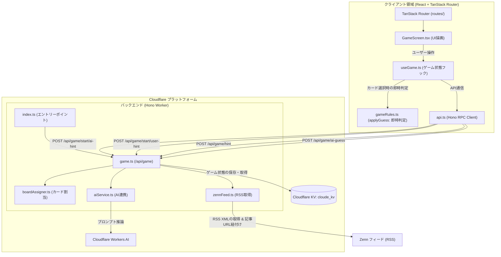

# システムアーキテクチャ & シーケンス設計

本ドキュメントでは、1人プレイ用コードネーム風ボードゲーム「Cloude」の主要なディレクトリ構成、システムアーキテクチャおよび主要なインタラクションシーケンスを解説します。

---

## 主要なディレクトリ構成

```
.
├── docs/                     # ドキュメント
├── public/                   # 画像
├── src/                      # フロントエンド（React + TanStack Router + Vite）
│   ├── components/           # UIコンポーネント
│   │   ├── ui/               # shadcn/uiコンポーネント
│   │   ├── GameBoard.tsx     # カードボード表示
│   │   ├── GameScreen.tsx    # ゲームメイン画面
│   │   ├── GameStatusOverlay.tsx # 勝敗オーバーレイ
│   │   ├── Header.tsx        # ロゴ・タイトル表示
│   │   ├── HintDisplay.tsx   # ヒント・枚数・推論理由の表示
│   │   ├── HintInputForm.tsx # 人間ヒント入力フォーム
│   │   └── ZennToggle.tsx    # Zennトレンド連動切り替えトグル
│   ├── hooks/                # カスタムフック
│   │   └── useGame.ts        # UI状態とAPI連携、ターン遷移の管理
│   ├── lib/                  # フロントエンドのロジック
│   │   ├── api.ts            # Hono RPC クライアント (hc)
│   │   ├── gameRules.ts      # 回答時の状態遷移・勝敗判定 (applyGuess)
│   │   └── utils.ts          # ユーティリティ
│   ├── routes/               # TanStack Router ルーティング
│   │   ├── __root.tsx        # ルートレイアウト
│   │   ├── index.tsx         # モード・カード枚数・Zenn連動選択画面
│   │   └── game.tsx          # ゲームプレイ画面
│   ├── types/                # フロントエンド共通型定義
│   │   └── game.ts
│   ├── routeTree.gen.ts      # 自動生成されたルートルートツリー
│   └── main.tsx              # フロントエンドエントリーポイント
└── worker/                   # バックエンド（Cloudflare Workers + Hono）
    ├── lib/                  # バックエンドのロジック
    │   ├── boardAssigner.ts  # スパイ・正解の割り当てロジック
    │   ├── hintParser.ts     # AIが返したヒントテキストの解釈
    │   ├── jsonParser.ts     # AIレスポンス(JSON/マークダウン)の安全なパース
    │   └── validation.ts     # ボード状態やAI出力スキーマの検証
    ├── routes/               # APIルーティング
    │   └── game.ts           # ゲーム関連API (/api/game/*)
    ├── services/             # 外部サービス連携
    │   ├── aiService.ts      # Cloudflare Workers AI の呼び出し（単語生成・ヒント生成・AI推論）
    │   └── zennFeed.ts       # Zenn RSS フィード取得
    ├── types.ts              # バックエンド型定義
    └── index.ts              # Workerのエントリーポイント
```

---

## 1. システムアーキテクチャ図

クライアントサイド（React + TanStack Router + Vite）とサーバーサイド（Cloudflare Workers + Hono）が、Cloudflare KV と Workers AI を介してどのように連携しているかを示す



---

## 2. シーケンス図

### 2.1 新規ゲーム開始シーケンス (AIヒントモード / 人間ヒントモード)
ゲームの開始時に必要に応じて Zenn RSS フィードからトレンド記事タイトルを取得し、キーワードを含むボード（単語・スパイ配置、9/16/25枚対応）を生成します。AIヒントモードではさらに最初のヒントを Workers AI で生成して KV に保存・クライアントへ返却します。

```mermaid
sequenceDiagram
    autonumber
    actor User as プレイヤー
    participant Client as クライアント (React / TanStack Router)
    participant Worker as バックエンド (Hono Worker)
    participant Zenn as Zenn RSS (zennFeed.ts)
    participant Assigner as 割当ロジック (boardAssigner.ts)
    participant KV as Cloudflare KV
    participant AI as Workers AI

    User ->> Client: モード・枚数・Zenn連動を選択して「ゲームを開始する」をクリック
    Client ->> Worker: POST /api/game/start/ai-hint または /start/user-hint

    opt Zenn連動が有効な場合
        Worker ->> Zenn: Zenn RSSフィードの取得・トレンド記事抽出
        Zenn -->> Worker: 記事タイトル・URL一覧 (ランダムに3件選出)
    end

    rect rgb(20, 30, 45)
        Note over Worker, AI: ボード単語生成
        Worker ->> AI: 指定枚数 (9/16/25) の単語生成要求
        AI -->> Worker: 生成された単語データ
        Worker ->> Assigner: 単語にスパイ／正解カード種別を割り当て (9枚:2 / 16枚:3 / 25枚:4)
    end

    alt AIヒントモードの場合
        rect rgb(20, 30, 45)
            Note over Worker, AI: 初期ヒント生成
            Worker ->> AI: 初期ヒント生成要求 (正解単語リスト vs スパイ単語リスト)
            AI -->> Worker: ヒント単語・枚数・reasoning
        end
    else 人間ヒントモードの場合
        Note over Worker: ヒント生成は行わず、スパイ配置を開示した状態で初期化
    end

    Note over Worker: ゲーム状態 (GameState) オブジェクトの構築
    Worker ->> KV: セッションIDをキーに GameState を保存
    Worker -->> Client: 初期 GameState (JSON)
    Client -->> User: 初期ボードと画面を表示
```



---

### 2.2 カード回答 & ヒント更新シーケンス (AIヒントモード)
AIヒントモードでプレイヤーがカードを選択した際のフロントエンド即時判定、および推測回数がなくなった場合の次のAIヒント取得の流れです。

> **Note:** このモードではカードの開示状態 (`revealed`) や勝敗の判定結果をサーバーへ同期しません。ゲーム進行の真の状態はクライアント側の React state が保持し、KV 上の GameState のボードはゲーム開始時の初期状態のままです。

```mermaid
sequenceDiagram
    autonumber
    actor User as プレイヤー
    participant Client as クライアント (React)
    participant Rule as ゲームルール (applyGuess)
    participant Worker as バックエンド (Hono Worker)
    participant KV as Cloudflare KV
    participant AI as Workers AI

    User ->> Client: カードをめくる (単語の選択)
    Client ->> Rule: applyGuess(gameState, word) の実行
    Note over Client: 即座にフロントエンド側で正誤判定

    alt スパイ単語をめくってしまった場合
        Client -->> User: ゲームオーバー (敗北)
    else すべての正解単語をめくった場合
        Client -->> User: ゲームクリア (勝利)
    else 正解単語だが、推測回数が残っている場合
        Client -->> User: めくったカードの色を「正解」にし、推測回数を減らして継続
    else 推測回数が 0 になった場合 (かつ未クリア) または 手動で「ヒント再生成」を押した場合
        Note over Client: ヒント要求処理を開始
        Client ->> Worker: POST /api/game/hint (sessionId と 未開示の正解単語・スパイ単語リスト)
        Worker ->> KV: セッションIDから GameState を取得 (単語リストのフォールバック用)
        Note over Worker: ヒント生成にはクライアントが送った単語リストを優先して使用
        rect rgb(20, 30, 45)
            Note over Worker, AI: 次のヒント生成
            Worker ->> AI: 次のヒント生成要求 (クライアント指定の未開示正解単語 vs スパイ単語)
            AI -->> Worker: 新しいヒント・枚数テキスト・reasoning
        end
        Worker ->> KV: currentHint / remainingGuesses を更新した GameState を保存 (ボードは初期状態のまま)
        Worker -->> Client: 新しいヒントと推測回数を返却
        Note over Client: 返却された gameState は使用せず currentHint / remainingGuesses のみローカル状態へマージ
        Client -->> User: 新しいヒントと推測回数を表示して継続
    end
```



---

### 2.3 人間ヒント & AI推論シーケンス (人間ヒントモード)
プレイヤーがスパイマスターとしてヒントと対象枚数を入力し、AIがカードを推理して開封する流れです。

> **Note:** このモードではクライアントは sessionId・ヒント・枚数のみを送信し、ボードの単語リストは送りません。カードの開示状態を含む GameState の真の状態はサーバー側 (Cloudflare KV) が保持し、クライアントはレスポンスの GameState をそのまま画面に反映します。

```mermaid
sequenceDiagram
    autonumber
    actor User as プレイヤー (スパイマスター)
    participant Client as クライアント (React)
    participant Worker as バックエンド (Hono Worker)
    participant KV as Cloudflare KV
    participant AI as Workers AI

    User ->> Client: ヒント単語 (最大10文字) と枚数を入力して送信
    Client ->> Worker: POST /api/game/ai-guess
    Worker ->> KV: セッションIDから現在のGameStateを取得
    
    rect rgb(20, 30, 45)
        Note over Worker, AI: AIによるカード推理
        Worker ->> AI: ヒント・枚数・未開封単語リストを送信し推論
        AI -->> Worker: 推論結果の単語リスト (guesses) と reasoning
    end

    Note over Worker: 推測単語を順に開封し正誤判定 (スパイなら即時敗北、全開示なら勝利)
    Worker ->> KV: 更新したGameStateを保存
    Worker -->> Client: 更新後のGameStateとreasoningを返却
    Client -->> User: 開封結果・勝敗・AIの思考理由を表示
```


